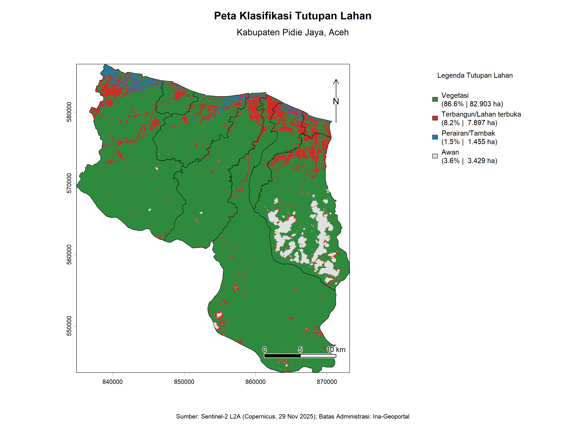
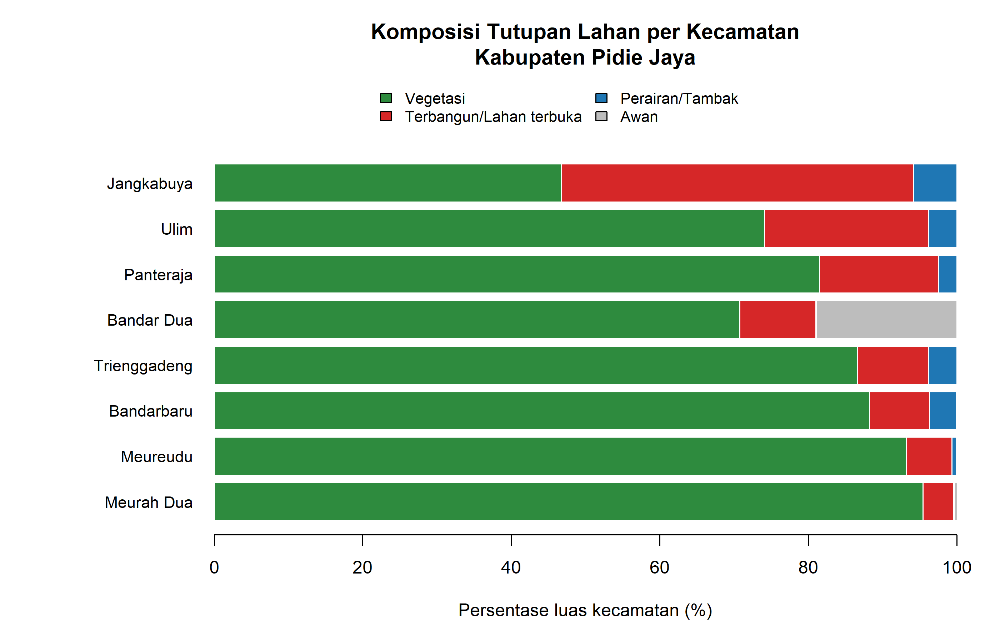
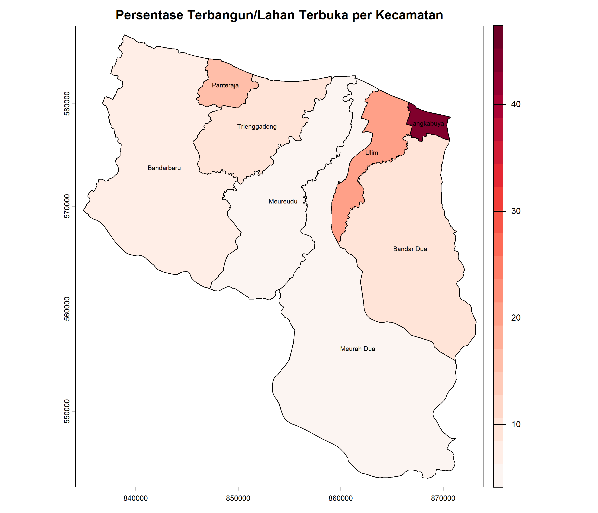
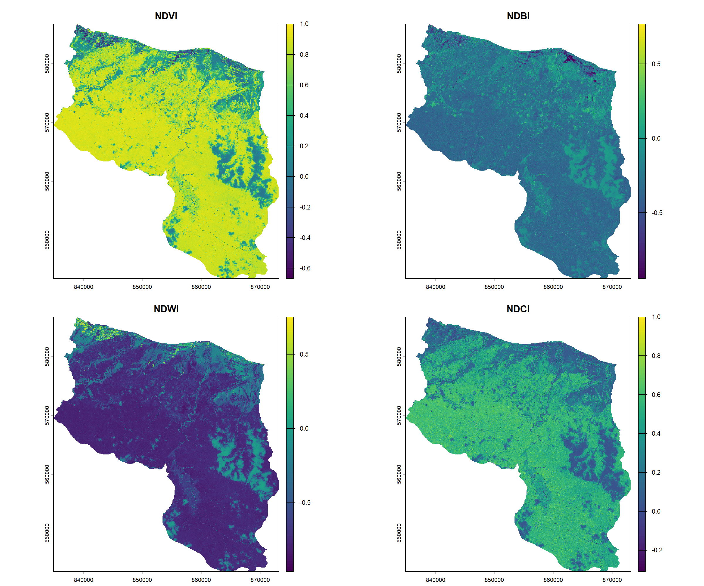

# Informasi Spasial Interaktif Kabupaten Pidie Jaya

Tugas Evaluasi Tengah Semester Pemrograman Spasial (CM234529), Departemen Teknik Geomatika, ITS.
Repositori ini berisi analisis indeks spektral dan klasifikasi tutupan lahan Kabupaten Pidie Jaya, Provinsi Aceh, menggunakan citra Sentinel-2 L2A dan R. Hasilnya disajikan dalam dashboard interaktif berbasis Shiny dan Leaflet.


**Disusun oleh:**

| Nama                  | NRP        |
|-----------------------|------------|
| Aisyah Meylinda Sari  | 5016241115 |
| Nabilla Putri Badrina | 5016241130 |

Kelas: Pemrograman Spasial A |
Dosen pengampu: Mohammad Rohmaneo Darminto, S.T., M.Sc.

---

## Tentang Proyek

Wilayah studi adalah Kabupaten Pidie Jaya (8 kecamatan), Provinsi Aceh. Kabupaten ini dipilih karena tutupan vegetasinya masih baik sehingga respons NDVI mudah diamati, serta memiliki permukiman, tambak, dan badan air dalam satu wilayah. Tujuan proyek:

1. Mengunduh dan memotong citra Sentinel-2 L2A sesuai batas Kabupaten Pidie Jaya.
2. Menghitung NDVI, NDBI, NDWI, dan NDCI serta menentukan threshold klasifikasi.
3. Menyusun peta komposit 4 kelas: vegetasi, terbangun/lahan terbuka, perairan/tambak, dan awan.
4. Menghitung statistik zonal indeks dan luas kelas per kecamatan.
5. Menyajikan hasil dalam peta statis dan dashboard interaktif.

## Data

| Data                 | Keterangan                                              | Sumber                               |
|----------------------|---------------------------------------------------------|--------------------------------------|
| Citra Sentinel-2 L2A | Tile T46NHL, akuisisi 29 November 2025 (baseline N0511) | ESA, Copernicus Data Space Ecosystem |
| Batas administrasi   | Kabupaten dan kecamatan skala 1:50.000 (shapefile)      | Ina-Geoportal, BIG                   |

Sistem koordinat: WGS 84 / UTM zona 46N. Band yang dipakai: B02, B03, B04, B08 (10 m) serta B05, B11, dan SCL (20 m, di-resample ke 10 m).

Data mentah dan data hasil olahan tidak disertakan di repositori karena ukurannya besar. Letakkan folder `.SAFE` di `data/raw/sentinel2/` dan shapefile batas di `data/raw/batas/`.

## Struktur Folder

```
├── data/
│   ├── raw/          ← citra Sentinel-2 dan shapefile (tidak di-push)
│   └── processed/    ← hasil crop, indeks, dan klasifikasi (tidak di-push)
├── R/
│   ├── 01_crop.R
│   ├── 02_indices.R
│   ├── 03_classify.R
│   ├── 04_zonal.R
│   └── 05_export.R
├── output/           ← peta PNG, tabel CSV, GeoPackage
├── 06_shiny.R        ← dashboard interaktif
└── README.md
```

## Penjelasan Skrip

| Skrip           | Fungsi                                                                               | Keluaran utama                                                             |
|-----------------|--------------------------------------------------------------------------------------|----------------------------------------------------------------------------|
| `01_crop.R`     | Membaca band, menyamakan resolusi ke 10 m, konversi DN ke reflektansi, crop dan mask | `pidiejaya_crop.tif`, `pidiejaya_scl.tif`                                  |
| `02_indices.R`  | Menghitung 4 indeks spektral dan membuat visualisasinya                              | `pidiejaya_indeks.tif`, `indeks_spektral.png`, `NDVI.png`, dst.            |
| `03_classify.R` | Menentukan threshold, klasifikasi 4 kelas, peta, validasi terhadap SCL               | `pidiejaya_kelas.tif`, `peta_klasifikasi.png`, `luas_kelas.csv`, `validasi_vs_SCL_*.csv` |
| `04_zonal.R`    | Luas kelas per kecamatan, grafik komposisi, zonal statistics indeks                  | `zonal_kecamatan_*.csv`, `zonal_indeks_pidiejaya.csv`, `sampel_indeks.csv` |
| `05_export.R`   | Luas kelas (km²), batas dalam GeoPackage, raster klasifikasi menjadi poligon WGS84   | `luas_kelas_*.csv`, `*.gpkg`                                               |
| `06_shiny.R`    | Dashboard interaktif yang membaca isi folder `output/`                               | Aplikasi Shiny                                                             |

## Metode

### Indeks spektral

| Indeks | Rumus                   | Kegunaan                |
|--------|-------------------------|-------------------------|
| NDVI   | (B8 − B4) / (B8 + B4)   | Vegetasi                |
| NDBI   | (B11 − B8) / (B11 + B8) | Lahan terbangun         |
| NDWI   | (B3 − B8) / (B3 + B8)   | Perairan (McFeeters)    |
| NDCI   | (B5 − B4) / (B5 + B4)   | Pendukung deteksi awan  |

Nilai digital dikonversi ke reflektansi dengan rumus (DN − 1000) / 10000 sesuai baseline N0511.

Ringkasan nilai indeks seluruh kabupaten:

| Indeks | Minimum | Rata-rata | Maksimum |
|--------|---------|-----------|----------|
| NDVI   | −0,808  | 0,705     | 1,000    |
| NDBI   | −0,944  | −0,280    | 0,770    |
| NDWI   | −1,000  | −0,632    | 0,863    |
| NDCI   | −0,452  | 0,423     | 1,000    |

### Penentuan threshold

Threshold ditentukan dengan membandingkan nilai indeks pada tiap kelas Scene Classification Layer (SCL) menggunakan 300.000 piksel sampel, lalu dicek secara visual. Hasilnya ada di `output/indeks_per_kelas_SCL.csv` dan `output/uji_threshold_SCL.csv`. SCL hanya dipakai sebagai acuan pembanding, bukan kebenaran lapangan.

Hasil uji threshold yang dipilih:

| Uji            | % piksel target lolos | % piksel kelas lain ikut lolos |
|----------------|-----------------------|--------------------------------|
| NDVI > 0,3     | 99,8                  | 40,0                           |
| NDWI > 0       | 55,5                  | 0,5                            |
| B02 > 0,15     | 77,1                  | 0,9                            |

NDWI > 0 dipilih untuk menekan masuknya piksel kelas lain, dengan konsekuensi sebagian piksel perairan (air keruh, perairan dangkal, tambak) tidak terdeteksi. NDBI tidak dijadikan kriteria utama karena selisih rata-rata antarkelas SCL kecil dan seluruhnya negatif.

### Aturan klasifikasi

Piksel valid diberi kelas default, lalu ditimpa berurutan (yang terakhir menang):

| Urutan | Kelas                   | Aturan                          |
|--------|-------------------------|---------------------------------|
| 1      | Terbangun/Lahan terbuka | Default (NDVI rendah)           |
| 2      | Vegetasi                | NDVI > 0,30                     |
| 3      | Perairan/Tambak         | NDWI > 0,00                     |
| 4      | Awan                    | \|NDCI\| < 0,05 dan B02 > 0,15  |

Pasca-pemrosesan:
- Gumpalan awan kurang dari 100 piksel (sekitar 1 ha) dibuang, lalu tepi awan diperluas dengan jendela 11 x 11.
- Noise "garam-merica" dihaluskan dengan filter modus 3 x 3.

## Hasil

### Luas tutupan lahan

| Kelas                   | Luas (ha) | Luas (km²) | Persentase |
|-------------------------|-----------|------------|------------|
| Vegetasi                | 82.903,07 | 829,03     | 86,64%     |
| Terbangun/Lahan terbuka | 7.897,33  | 78,97      | 8,25%      |
| Perairan/Tambak         | 1.454,81  | 14,55      | 1,52%      |
| Awan                    | 3.429,46  | 34,29      | 3,58%      |

### Peta klasifikasi



### Komposisi per kecamatan

| Kecamatan    | Total (km²) | Vegetasi (%) | Terbangun/Lahan terbuka (%) | Perairan/Tambak (%) | Awan (%) |
|--------------|-------------|--------------|-----------------------------|---------------------|----------|
| Bandar Dua   | 173,34      | 70,74        | 10,24                       | 0,09                | 18,93    |
| Bandarbaru   | 222,38      | 88,18        | 8,09                        | 3,63                | 0,10     |
| Jangkabuya   | 9,56        | 46,74        | 47,39                       | 5,87                | 0,00     |
| Meurah Dua   | 292,38      | 95,43        | 4,13                        | 0,07                | 0,38     |
| Meureudu     | 125,63      | 93,20        | 6,12                        | 0,57                | 0,11     |
| Panteraja    | 18,99       | 81,47        | 16,04                       | 2,47                | 0,02     |
| Trienggadeng | 75,67       | 86,59        | 9,61                        | 3,79                | 0,01     |
| Ulim         | 41,04       | 74,07        | 22,06                       | 3,84                | 0,02     |





Vegetasi tertinggi ada di Meurah Dua (95,43%) dan terendah di Jangkabuya (46,74%), yang proporsi terbangun/lahan terbukanya hampir sama besar (47,39%). Awan paling banyak menutupi Bandar Dua (18,93%), sehingga hasil klasifikasi di kecamatan ini perlu ditafsirkan hati-hati.

### Indeks spektral



### Zonal statistics

Statistik (mean, min, max, median, standar deviasi) dihitung untuk NDVI, NDBI, NDWI, dan NDCI pada setiap kecamatan. Rata-rata per kecamatan:

| Kecamatan    | NDVI   | NDBI    | NDWI    | NDCI   |
|--------------|--------|---------|---------|--------|
| Bandar Dua   | 0,5667 | −0,2154 | −0,5134 | 0,3056 |
| Bandarbaru   | 0,7314 | −0,3040 | −0,6463 | 0,4595 |
| Jangkabuya   | 0,3055 | −0,2145 | −0,3391 | 0,1774 |
| Meurah Dua   | 0,7892 | −0,3128 | −0,7018 | 0,4757 |
| Meureudu     | 0,7701 | −0,2826 | −0,6880 | 0,4771 |
| Panteraja    | 0,6024 | −0,2451 | −0,5607 | 0,3357 |
| Trienggadeng | 0,6518 | −0,2490 | −0,5942 | 0,3856 |
| Ulim         | 0,5809 | −0,2579 | −0,5501 | 0,3487 |

Kecamatan dengan NDVI rata-rata tertinggi adalah Meurah Dua (0,789) dan terendah Jangkabuya (0,305). Jangkabuya juga memiliki NDBI dan NDWI rata-rata tertinggi.

Tabel lengkap:
- Zonal indeks: `output/zonal_indeks_pidiejaya.csv`
- Luas kelas per kecamatan: `output/luas_kelas_per_kecamatan.csv`
- Ringkasan lengkap: `output/zonal_kecamatan_ringkas.csv`

### Validasi terhadap SCL

Hasil klasifikasi dibandingkan dengan SCL (persen per baris), tersedia di `output/validasi_vs_SCL_persen.csv` dan `output/validasi_vs_SCL_piksel.csv`.

| Kelas hasil klasifikasi | Kelas SCL dominan | Kesesuaian |
|-------------------------|-------------------|------------|
| Vegetasi                | Vegetasi          | 89,8%      |
| Perairan/Tambak         | Air               | 80,2%      |
| Terbangun/Lahan terbuka | Non-vegetasi      | 72,3%      |
| Awan                    | Awan tinggi (69,3%) dan awan sedang (25,2%) | 94,5% |

SCL bukan data kebenaran lapangan, jadi angka ini bukan nilai akurasi terhadap kondisi sebenarnya.

## Dashboard Interaktif

Dibuat dengan Shiny Dashboard dan Leaflet. Menu yang tersedia:

| Menu      | Isi                                                                                 |
|-----------|-------------------------------------------------------------------------------------|
| Maps      | Tutupan Lahan OSM, Dark Map, Heatmap Terbangun, Choropleth Kecamatan, Zonal Indeks |
| Statistik | Statistik indeks (tabel, histogram, grafik) dan luas kelas per kecamatan            |
| Metode    | Dasar threshold, validasi vs SCL, galeri peta statis                                |

Setiap peta dilengkapi kartu judul, skala, panah utara, dan sumber data. Layer pada peta utama bisa dinyalakan atau dimatikan.

## Cara Menjalankan

1. Download repositori ini, lalu buka dari folder utama proyek (bukan dari dalam folder `R/`) agar path relatif terbaca.
2. Pasang package:
```r
   install.packages(c("terra", "sf", "shiny", "shinydashboard",
                      "leaflet", "leaflet.extras"))
```
3. Untuk menjalankan analisis dari awal, unduh data mentah dari sumber di atas, simpan di `data/raw/`, lalu jalankan `R/01_crop.R` sampai `R/05_export.R` secara berurutan.
4. Untuk membuka dashboard, buka `06_shiny.R` lalu klik **Run App > Run External**. Data yang dibutuhkan ada di folder `output/`.

## Catatan

- Setiap skrip diawali pengaturan `PROJ_LIB` dan `PROJ_DATA` karena proyeksi sempat galat akibat bentrok dengan PROJ dari instalasi PostgreSQL. Bagian ini harus dijalankan sebelum `library(terra)`.
- `04_zonal.R` dan `05_export.R` membutuhkan hasil `03_classify.R`. `06_shiny.R` membutuhkan seluruh keluaran skrip 01 sampai 05.
- Kelas "Terbangun/Lahan terbuka" bisa mencakup lahan kosong atau tanah terbuka karena didefinisikan dari NDVI rendah, tidak hanya bangunan.
- Kelas "Perairan/Tambak" mencakup tambak di wilayah pesisir utara. NDWI > 0 hanya mendeteksi sebagian piksel air (55,5% menurut SCL).
- Pendekatan awan (|NDCI| < 0,05 dan B02 > 0,15) tidak menangkap seluruh awan dan tidak menangkap bayangan awan.
- Dashboard memuat font Poppins dari Google Fonts. Jika offline, font cadangan dipakai otomatis.
- Folder `data/` tidak ikut di-push, sedangkan `output/` boleh.

## Keterbatasan

- **Tutupan awan.** Awan paling banyak menutupi Kecamatan Bandar Dua (18,93%), sehingga komposisi tutupan lahan di kecamatan ini kurang mewakili kondisi permukaan sebenarnya. Pendekatan deteksi awan (|NDCI| < 0,05 dan B02 > 0,15) juga tidak menangkap seluruh awan, dan bayangan awan tidak terdeteksi.
- **NDWI hanya menangkap sebagian air.** Dengan threshold NDWI > 0, hanya 55,5% piksel air menurut SCL yang terdeteksi. Air keruh, perairan dangkal, dan tambak bisa bernilai NDWI rendah, begitu pula piksel di batas air dan daratan yang spektralnya campuran.
- **SCL bukan kebenaran lapangan.** SCL hanya dipakai sebagai acuan pembanding, sehingga persentase kesesuaian pada validasi bukan nilai akurasi terhadap kondisi sebenarnya. Validasi dengan data lapangan atau citra resolusi tinggi belum dilakukan.
- **Kelas terbangun/lahan terbuka bersifat gabungan.** Kelas ini didefinisikan dari NDVI rendah, jadi mencakup lahan kosong dan tanah terbuka, tidak hanya bangunan.
- **Satu tanggal akuisisi.** Hasil hanya menggambarkan kondisi pada 29 November 2025 dan belum bisa dipakai untuk melihat perubahan tutupan lahan dari waktu ke waktu.

## Tools

R, RStudio, terra, sf, Shiny, shinydashboard, Leaflet, leaflet.extras

## Sumber

- Citra: Sentinel-2 L2A, ESA Copernicus
- Batas administrasi: Ina-Geoportal, Badan Informasi Geospasial (BIG)